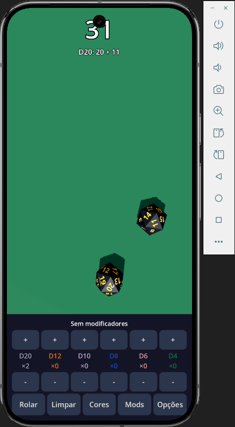

# Rolador de Dados RPG (Godot 4.3+)

Rolador de dados 3D com física para celular: **D20, D12, D10, D8, D6 e D4**.

## Como abrir
1. Instale o [Godot 4.3 ou mais novo](https://godotengine.org/download) (versão padrão, não precisa do .NET).
2. Abra o Godot → **Importar** → selecione o `project.godot` desta pasta.
3. Na primeira abertura, espere a importação terminar e aperte **F5** (Executar).

No computador: clique na área verde (ou aperte **Espaço**) para "pular" os dados.

## Como usar
| Ação | O que faz |
|---|---|
| **+ / −** sob cada dado | adiciona ou remove um dado daquele tipo (os dados novos caem na mesa) |
| **Tocar na mesa** / botão **Rolar** | os dados que já estão na mesa pulam e rolam de novo |
| **Chacoalhar o celular** | mesma coisa que tocar (ligue/desligue e ajuste a força em *Opções*) |
| **Limpar** | remove todos os dados |
| **Cores** | escolha um tipo de dado e ajuste RGB do corpo e dos números; há *Aleatória*, *Padrão* e *Aplicar a todos* |
| **Mods** | modificadores aplicados **na ordem**, sobre a soma: `+`, `−`, `×`, `÷` |
| **Opções** | chacoalhar, vibração, D10 (0 vale 10 ou 0), arredondamento das divisões |

Os resultados aparecem no topo: total grande e, abaixo, o detalhe por tipo de dado e os passos dos modificadores.
Cores, modificadores e opções são salvos automaticamente.

### Regras de leitura
- O número lido é o da **face voltada para cima** (no D4, o do **vértice** mais alto).
- Se um dado parar inclinado (apoiado em outro dado ou na parede) ele ganha até 3 empurrões extras.
- Faces opostas somam (menor + maior): D6 = 7, D8 = 9, D12 = 13, D20 = 21.
- Divisão arredonda para baixo por padrão (mude em *Opções*). `÷ 0` é ignorado.

## Limitador de tela
A câmera olha a mesa de cima. Quatro paredes invisíveis e um teto são recalculados a partir do tamanho real da
área 3D (`mesa.gd → ajustar()`), inclusive ao girar a tela, então os dados nunca saem da vista.

## Exportar para celular
**Android**
1. *Editor → Gerenciar templates de exportação* → baixe os templates.
2. Instale o JDK 17 e o Android SDK (veja *Editor Settings → Export → Android*).
3. *Projeto → Exportar → Adicionar → Android*. Em *Permissions* marque **Vibrate** (para a vibração).
4. Em *Project Settings → Input Devices → Sensors* confirme **Enable Accelerometer** (já vem ligado).
5. Exporte um `.apk` e instale no aparelho (ou use *Deploy with Remote Debug*).

**iOS**: exporte pelo preset iOS e abra o projeto gerado no Xcode (requer macOS).

O projeto usa o renderizador **Compatibilidade (GL)**, que roda em praticamente qualquer celular.

## Personalização rápida
- **Tamanho dos dados**: `RADIUS` em `scripts/dice_factory.gd`.
- **Quantidade de dados**: `MAX_DICE` em `scripts/main.gd`.
- **Força do pulo**: `pular()` em `scripts/die.gd`; **gravidade** em *Project Settings → Physics → 3D*.
- **Tamanho da mesa**: `CAMPO_LARGURA` em `scripts/mesa.gd` (menor = dados maiores na tela).
- **Cores padrão**: `DEFAULT_COLORS` em `scripts/main.gd`.
- **Se os números aparecerem de cabeça para baixo**: troque `FLIP_V` para `true` em `scripts/dice_factory.gd`.

## Como funciona
Os dados são gerados por código (`dice_geometry.gd`): mesh facetado, colisão por casco convexo e um atlas de números
desenhado em tempo real. O shader (`shaders/dado.gdshader`) mistura a cor do corpo com a dos números, por isso a troca
de cor é instantânea e vale para todos os dados do mesmo tipo.

## Apresentação

- O APk completo pode ser baixado [aqui](https://github.com/Igor-Wolf/DiceRollerGodot/releases/download/v1.0/Dice.Roller.apk).